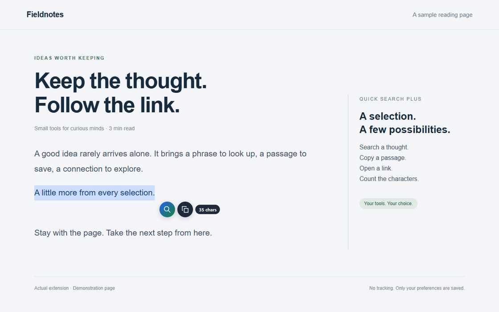
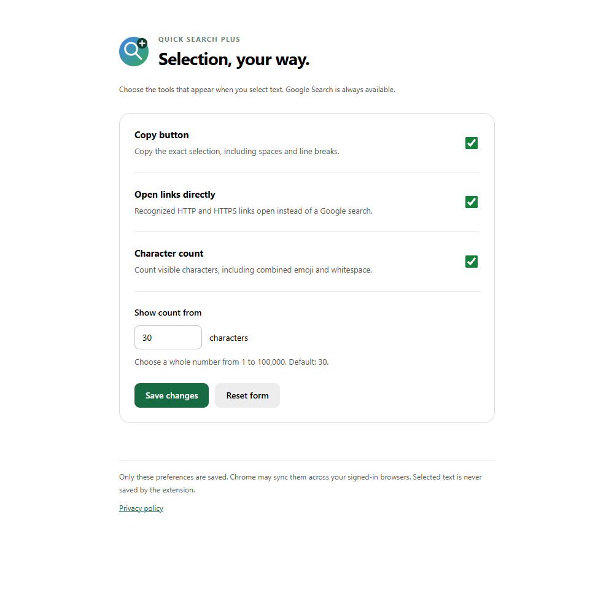

<p align="center"></p>

<h1 align="center">Quick Search Plus</h1>
<p align="center">選択した先に、いつもの操作を。</p>
<p align="center">検索・コピー・リンクを開く・文字数確認。読んでいる場所から、すぐに。</p>

<p align="center">
  
  <a href="LICENSE"></a>
  
</p>
<p align="center"><a href="README.md">English</a> · 日本語</p>



## 選択したところから、次の操作へ

単語、文章、Webアドレスを選択すると、小さな丸い操作ボタンが表示されます。Google検索、選択した内容のコピー、URLを新しいタブで開く操作へすぐに移れます。長い選択には文字数も表示。追加機能はそれぞれオフにできます。

| 操作 | 動作 |
| --- | --- |
| 検索 | 読んでいるページを残したまま、新しいタブでGoogle検索。 |
| リンクを開く | HTTP・HTTPSのURLと判定した場合、そのアドレスを直接開きます。ホバーやフォーカスで移動先のホスト名を確認できます。 |
| コピー | 前後の空白や改行も含めてコピー。成功するとチェックマークで知らせます。 |
| 文字数 | 指定した文字数以上で表示。結合した絵文字も1文字として数えます。 |

[Quick Google Search](https://github.com/Kaito-Rowing/quick-google-search)の兄弟拡張機能です。検索だけならそちらを、コピーや文字数も使いたいならPlusを選べます。操作ボタンが重複しないよう、同時に有効にするのは片方がおすすめです。

## インストール

現在、Chrome ウェブストアには掲載していません。ローカルにインストールできます。

1. [拡張機能のZIPをダウンロード](https://github.com/Kaito-Rowing/quick-search-plus/releases/download/v1.2.1/quick-search-plus-1.2.1.zip)して展開するか、リポジトリをcloneします。
2. Chromeで `chrome://extensions` を開き、**デベロッパー モード**を有効にします。
3. **パッケージ化されていない拡張機能を読み込む**を選び、`manifest.json` のあるフォルダを指定します。
4. すでに開いていたWebページを再読み込みします。

配布用ZIPを受け取った場合も、展開したフォルダを手順3で選びます。インストール中はフォルダを移動・削除しないでください。Chrome 123以降が必要です。セキュリティ更新のため、現行のChromeをご利用ください。

## 操作と設定

テキストを選択し、操作ボタンをクリックします。キーボードの場合、選択後にTabで検索・リンクボタンへ移動し、もう一度Tabでコピーへ。EnterまたはSpaceで実行できます。Escape、選択解除、スクロール、リサイズ、タブを離れる操作で非表示になります。

**拡張機能 → Quick Search Plus → オプション**、または `chrome://extensions` の **詳細 → 拡張機能のオプション**から変更できます。

| 設定 | 初期値 |
| --- | --- |
| コピーボタン | オン |
| リンクを直接開く | オン |
| 文字数表示 | オン |
| 文字数を表示する最小値 | 30文字 |

保存すると、すでに開いているページにも反映されます。**初期値に戻す**はフォームだけを戻す操作で、保存すると適用されます。最小値は1〜100,000の整数を指定できます。操作ボタンと設定画面は、Chromeの日本語・英語の設定に従います。



### 動作の詳細と対応範囲

- `example.com/path`、`www.example.com`、HTTP・HTTPS付きのドメインURL、日本語などの国際化ドメインをリンクとして扱います。スキームのないドメインにはHTTPSを補います。メールアドレス、認証情報入りURL、別のスキーム、localhost、IPアドレス、不正なアドレスは検索になります。サイトの存在や安全性までは検証しません。URLの周囲の句読点は含めずに選択してください。
- 検索では前後の空白を除き、コピーでは残します。文字数はUnicodeの書記素クラスタを基準とし、選択した空白や改行も含みます。バイト数やUTF-16のコード単位数ではありません。クリップボードの改行形式はOSに従う場合があります。
- コピーはクリックまたはキーボードで明示的に実行したときだけ行います。Clipboard APIが使えない・失敗した場合は従来のコピー処理を試し、選択範囲を復元します。どちらも失敗した場合は失敗を表示し、Ctrl+C／Command+Cを案内します。
- HTTP・HTTPSページのメインフレームが対象です。Chromeの内部ページ、Chrome ウェブストア、内蔵PDFビューア、ローカルファイル、フレーム内、閉じたShadow DOM内のテキストには対応していません。独自の選択処理や特殊なレイアウトを持つサイトでは干渉する場合があります。
- パスワード欄、入力欄、テキストエリア、リッチテキストエディタなどの編集領域は対象外です。長すぎる検索語句はブラウザやGoogleのURL制限にかかるため、短い範囲を選んでください。

## プライバシーと権限

| アクセス・権限 | 用途 |
| --- | --- |
| HTTP・HTTPSのコンテンツスクリプト | 選択検出と操作ボタンの表示。Chromeではサイトのデータの読み取り・変更と表示される場合があります。アクセス先は拡張機能の設定で制限できます。 |
| `storage` | 4つの設定だけをChromeの `storage.sync` に保存。Chrome同期が有効な場合、ログイン中のブラウザ間で同期されることがあります。 |
| `clipboardWrite` | コピー操作を実行したときだけクリップボードへ書き込み。読み取り権限は要求しません。 |

アクセス解析、広告、開発者のサーバー、リモートコードはありません。選択テキストは一時的にメモリで扱い、拡張機能のストレージへ保存しません。検索はGoogleへ送信、リンクを開く操作はそのサイトへ移動、コピーはOSのクリップボードへ書き込みます。OS側の履歴・同期や、Google・移動先サイト・ブラウザの履歴に残る可能性があります。新しいタブには `noopener,noreferrer` を指定しています。

詳しくは[プライバシーポリシー](docs/PRIVACY.ja.md)をご覧ください。Googleとは関係のない独立したプロジェクトです。

## 開発

拡張機能自体にビルド処理や実行時の依存パッケージはありません。開発にはNode.js 24とnpmを使います。

```sh
npm ci
npx playwright install chromium
npm run check
npm test
npm run package
```

単体テストではURL判定・文字数・設定値を、ブラウザテストでは実際の拡張機能と設定画面・Chromeストレージを確認します。コピー・保存の失敗テストではAPIの失敗を注入します。通常の検索・URL遷移・コピー・設定操作は実際のAPIを利用し、テスト中の外部ページへの遷移は捕捉して外部送信を防ぎます。

配布用ZIPは必要なファイルだけを収録し、`dist/quick-search-plus-1.2.1.zip` に生成します。CIでも検証・テスト・ZIP生成を実行します。編集後は拡張機能と対象ページを再読み込みしてください。[貢献ガイド](CONTRIBUTING.md)と[公開手順](docs/RELEASING.md)も用意しています。

## フィードバック・ライセンス

不具合は[Issue](https://github.com/Kaito-Rowing/quick-search-plus/issues/new/choose)へ。Chromeのバージョン、OS、公開できるURL、再現手順を添えてください。非公開の文章や個人情報は載せないでください。

[MIT](LICENSE) © 2026 Kaito-Rowing。[Quick Google Search](https://github.com/Kaito-Rowing/quick-google-search)を基に開発しています。
