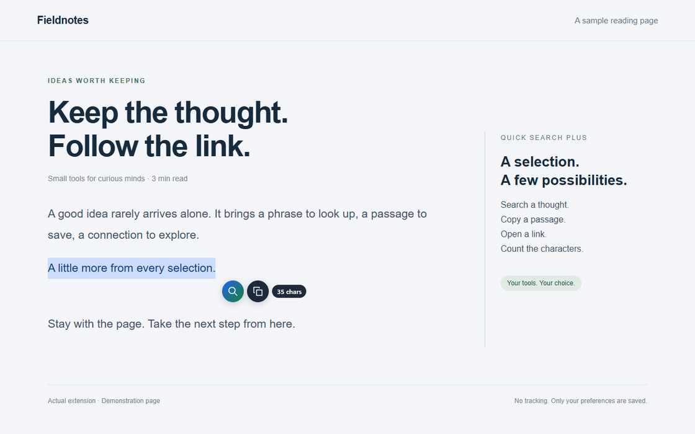
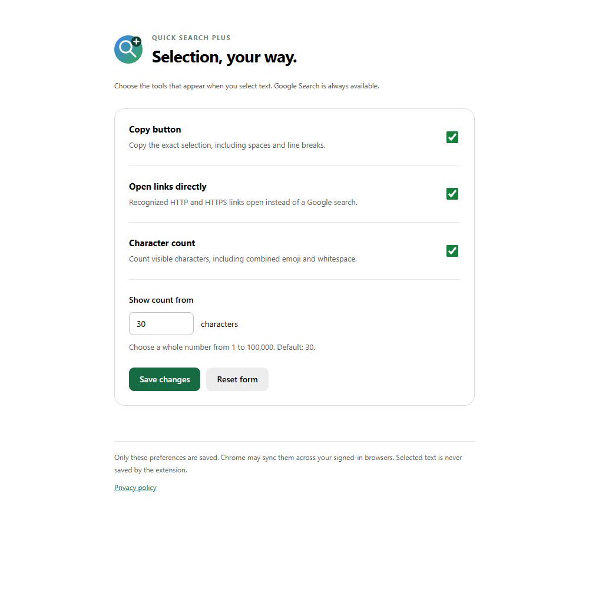

<p align="center"></p>

<h1 align="center">Quick Search Plus</h1>
<p align="center">A little more from every selection.</p>
<p align="center">Search, copy, open links and count characters—right where you read.</p>

<p align="center">
  
  <a href="LICENSE"></a>
  
</p>
<p align="center">English · <a href="README.ja.md">日本語</a></p>



## From a selection to your next step

Select a word, a passage or a web address. A small set of round buttons appears nearby. Search Google, copy the selection, or open a recognized link in a new tab. Longer selections get a character count. Every extra is optional.

| Action | What happens |
| --- | --- |
| Search | Open Google Search in a new tab. The original page stays open. |
| Open link | Recognized HTTP/HTTPS addresses open directly. Hover or focus to check the destination host. |
| Copy | Copy the selection, including leading/trailing spaces and line breaks. A check mark confirms success. |
| Count | Show the count at your chosen threshold. Combined emoji count as one character. |

This is the sibling of [Quick Google Search](https://github.com/Kaito-Rowing/quick-google-search). Choose that extension for search alone; choose Plus for the extra selection tools. Install one at a time to avoid duplicate controls.

## Install

There is currently no Chrome Web Store listing. To install locally:

1. [Download the extension ZIP](https://github.com/Kaito-Rowing/quick-search-plus/releases/download/v1.2.1/quick-search-plus-1.2.1.zip) and extract it, or clone this repository.
2. Open `chrome://extensions` in Chrome and enable **Developer mode**.
3. Choose **Load unpacked** and select the folder containing `manifest.json`.
4. Refresh any web pages that were already open.

If you receive a packaged release ZIP, extract it and select that folder in step 3. Keep the folder in place while installed. Chrome 123 or later is required; use a current Chrome version for security updates.

## Use & customize

Select text, then click an action. With the keyboard, select text and press Tab to reach the primary action; another Tab reaches Copy. Activate with Enter or Space. Escape, selection clearing, scrolling, resizing or leaving the tab dismisses the tools.

Open **Extensions → Quick Search Plus → Options** (or **Details → Extension options** at `chrome://extensions`) to customize:

| Preference | Default |
| --- | --- |
| Copy button | On |
| Open links directly | On |
| Character count | On |
| Show count from | 30 characters |

Save to apply changes to already-open pages. **Reset form** restores defaults in the form; save to apply them. The threshold accepts whole numbers from 1 to 100,000. Buttons and settings follow Chrome's English or Japanese UI language.



### Details & limits

- Link detection accepts ordinary domains such as `example.com/path`, `www.example.com`, and explicit HTTP/HTTPS domain URLs, including internationalized domains. Bare domains use HTTPS. Email addresses, credentials in URLs, other schemes, localhost, IP literals and malformed addresses are searched instead. Detection does not check whether a site exists or is trustworthy. Select the address without surrounding punctuation.
- Search trims surrounding whitespace; copying retains it. Counts use Unicode grapheme clusters and include selected whitespace and line breaks, rather than bytes or UTF-16 code units. Clipboard line endings may follow the operating system's conventions.
- Clipboard writes require an explicit click or keyboard activation. When the Clipboard API is unavailable or fails, the extension tries a legacy copy fallback and restores the selection. If both paths fail, it reports failure and suggests Ctrl+C / Command+C.
- Runs in the main frame of HTTP/HTTPS pages. Chrome internal pages, the Chrome Web Store, the built-in PDF viewer, local files, text inside frames and closed shadow trees are not supported. Custom selection handlers and unusual layouts may interfere.
- Form fields and editable regions, including passwords, text inputs, textareas and rich-text editors, are intentionally excluded. Very long searches can exceed browser or Google URL limits; choose a shorter passage.

## Privacy & permissions

| Access | Purpose |
| --- | --- |
| HTTP/HTTPS content script | Detect the current selection and display the controls. Chrome may describe this as reading and changing site data; site access can be restricted in extension settings. |
| `storage` | Save only the four preferences in Chrome's `storage.sync`. They may sync across signed-in browsers when Chrome Sync is enabled. |
| `clipboardWrite` | Write selected text after you explicitly activate Copy. No clipboard-read permission is requested. |

No analytics, ads, developer-operated server or remote executable code. Selected text is used temporarily in memory, not saved in extension storage. Search sends it to Google; Open link navigates to the selected destination; Copy writes it to the system clipboard, which may have OS-level history or sync. Google, visited sites and the browser may retain searches or navigation history. New tabs use `noopener,noreferrer`.

See the [privacy policy](PRIVACY.md). This is an independent project, not affiliated with Google.

## Development

No build step or runtime dependencies. Node.js 24 and npm are needed for development only.

```sh
npm ci
npx playwright install chromium
npm run check
npm test
npm run package
```

Unit tests cover URL parsing, grapheme counts and settings validation. Browser tests load the actual unpacked extension and use its real options page and Chrome storage. Clipboard/storage failure tests inject failures; normal search, URL navigation, copy and settings paths use the real APIs. Test navigation is intercepted so sample selections do not reach external destinations.

Packaging creates `dist/quick-search-plus-1.2.1.zip` from an explicit runtime-file allowlist. CI runs validation, tests and packaging. After editing, reload the extension and refresh the test page. See [CONTRIBUTING.md](CONTRIBUTING.md) and [the release guide](docs/RELEASING.md).

## Feedback & license

[Report a bug](https://github.com/Kaito-Rowing/quick-search-plus/issues/new/choose) with your Chrome version, OS, a public URL if possible and reproduction steps. Leave private selected text out of reports.

[MIT](LICENSE) © 2026 Kaito-Rowing. Derived from [Quick Google Search](https://github.com/Kaito-Rowing/quick-google-search).
